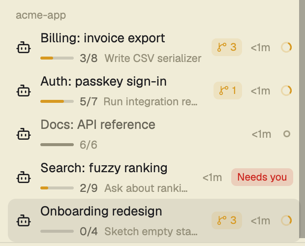
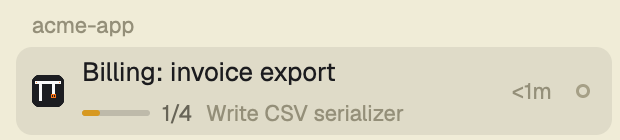
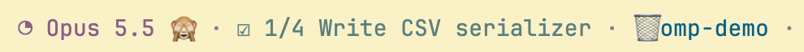

# herdr-omp-progress

Shows what [omp](https://github.com/can1357/oh-my-pi) agents are doing in the
[Herdr](https://herdr.dev) desktop app's **Agents** panel and in omp's own status line:

- **Subagent count**: how many omp subagents are working, per nesting level (`⑂ 2 › 1`).
- **Todo progress**: a progress bar, `done/total`, and the task in hand, under the agent's name.
- **Subagent progress**, for sessions that delegate instead of keeping a todo list: the same
  line with a branch icon, `⑂ 2/5`, the subagent the session is waiting on, and failures.
  The bar counts running subagents by their own completion estimate.
- **omp status line**: `☑ 4/11 Current task` and `⑂ 2/5 40% Waiting on` in the `status` segment.



A real omp session: the todo list it is working through shows under its name in Herdr…



…and in omp's own status line.



## Parts

| Path | What it does |
| --- | --- |
| `omp/extensions/herdr-subagent-count.ts` | Publishes working subagents on the herdr terminal as the label `agents.subs` (`"2,1"`). |
| `omp/extensions/herdr-todo-progress.ts` | Publishes the main session's todo list as `agents.todo` (`"4/11"`) and `agents.todoNow`, and sets the omp status `todo`. |
| `omp/extensions/herdr-subagent-progress.ts` | Publishes the subagents of the current prompt as `agents.tasks` (`"2/5"`), `agents.tasksPct`, `agents.tasksNow`, `agents.tasksFail`, and sets the omp status `subagents`. |
| `mods/agents-stacked/` | Agents panel (a fork of Herdr's built-in `agents` mod 0.1.12) that draws those labels. See [RECIPE.md](RECIPE.md). |

The extensions talk to Herdr only through `hc label`, so they do nothing outside Herdr
(except the status line, which works anywhere).

## Install

```sh
git clone https://github.com/fedorovvvv/herdr-omp-progress.git
cd herdr-omp-progress
./install.sh            # symlinks; `git pull` updates in place
./install.sh --copy     # copies instead
./install.sh --uninstall
```

Existing files of the same name are backed up as `*.bak`. Paths can be overridden with
`OMP_EXTENSIONS_DIR` and `HERDR_MODS_DIR`.

Then:

1. Restart running omp sessions so they load the extensions.
2. In Herdr, put the `agents-stacked` mod where the Agents panel goes (it ships with
   `"place": "none"`), or point your layout at it.
3. For the status line with `statusLine.preset: custom`, keep `status` in
   `leftSegments` or `rightSegments`.

## Subagent progress

A batch is every subagent the main agent spawns after a prompt (`task`, eval `agent()`,
workpool workers). It keeps growing while the agent spawns more, stays on screen once done,
and a new prompt starts the next one; a prompt sent while subagents still run steers the
same batch.

- `done/total` counts the main agent's own subagents; failed and aborted ones count as done
  and also show as `N failed`.
- The bar (`agents.tasksPct`) counts a finished subagent whole and a running one by omp's
  completion probe (`task.completionProbe`, the estimate the task UI shows); without one, by
  how far that subagent's own subagents got, at most 95%.
- The text is the running subagent furthest from done: its label and current step.
- With a todo list the line shows the todo list; the subagent numbers move to its tooltip.

Lifecycle uses public extension events and the `task:subagent:*` frames on the event bus.
Queued spawns and the current step come from omp internals (agent registry, async job
manager); on an omp build without them those two parts are missing and the rest works.

## Try it without an agent

```sh
hc label t12 'agents.todo=4/11' 'agents.todoNow=Some task' 'agents.subs=2,1'
hc label t12 'agents.tasks=2/5' 'agents.tasksPct=48' 'agents.tasksNow=Audit auth: reading middleware' 'agents.tasksFail=1'
hc label t12 'agents.todo=' 'agents.todoNow=' 'agents.subs=' 'agents.tasks=' 'agents.tasksPct=' 'agents.tasksNow=' 'agents.tasksFail='
```

## License

MIT
