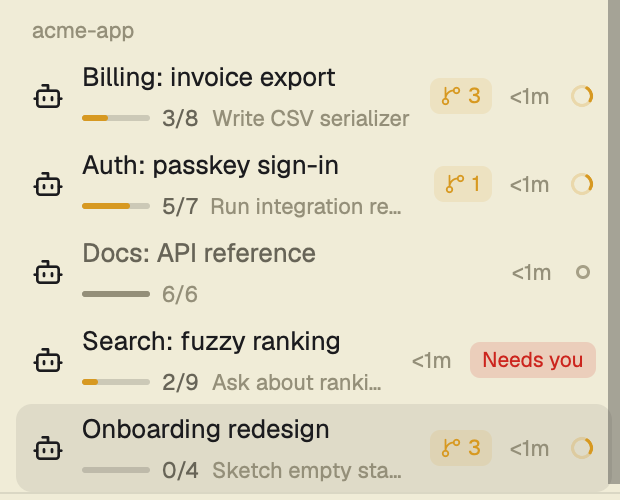

# Agents stacked

The sidebar's Agents panel, grouped by space, where every omp agent also says how many
subagents it has working and how far it is through its work: a thin progress bar,
`done/total`, and what is in hand, on a second line under the agent's name. The work is its
todo list when it keeps one, else the subagents it started for the current prompt.

## What you see

Top to bottom, in the sidebar region the layout gives the mod (`t.chrome` background, 1px
`t.border` line on top, 13px text):

- **Header**, 41px: `Agents` (11.5px, medium, `t.dim`) on the left; on the right a 14px
  sort icon that opens the sort menu.
- **Group headers**, 30px: the space name (11px, medium, `t.dim`); folded, the member count
  and the most urgent status.
- **Agent rows**, 8px rounded, 8px side padding:
  - 16px program icon from the app's program table;
  - the name: a tab someone named, else the agent's title with leading spinners/`π ` cut;
    `t.foreground`, `t.muted` when idle and not focused;
  - **progress line** (only when the agent has a todo list or a subagent batch), 11px `t.dim`:
    a 34×3px bar on `t.input`, filled with `t.working` (`t.done` once everything is done,
    `t.dim` when idle) to the share done; then `done/total` in `t.muted`, after a 10px
    `git-branch` icon for subagents; `N failed` in `t.blocked` when subagents failed; then the
    current task or the subagent the agent waits on, truncated;
  - **subagent chip**, 18px, `t.working` text on `t.working` at 12% alpha: a branch icon and
    the count of working subagents, either the total (`2`) or per level (`2 › 1`);
  - time since the agent's status last changed (11px `t.dim`), swapped for a pin button on hover;
  - the status mark.
  Row height: 30px, +12px when the space name sits above the title (priority sort, pinned),
  +14px with a progress line.
- **Subagent rows**, 26px (+14px with a progress line), indented 39px, with tree lines:
  subagents that have their own pane.
- Narrow sidebar (under 160px): rows shrink to a number and a status mark, and `»` at the
  bottom widens the sidebar again.

## How it behaves

- **Statuses**: working is a spinning 12px `spinner.svg` in `t.working`; blocked is a
  `Needs you` chip (a `!` under a Needs you header); done is a 7px dot in `t.done`; idle is a
  7px ring in `t.idle`.
- A done agent you look at turns idle but stays in Done until you leave it.
- Click a row: focus its pane. Click the icon of a row with subagent rows, or the chevron:
  fold them. Click a group header: fold the group.
- Click the subagent chip: switch total ↔ per level (shared setting `agents.subsView`).
- Hover a row: the time becomes a pin; pinned agents go to a Pinned group on top.
- Hover the progress line: tooltip `Todo: 3 of 8 done — now: <task>`, or
  `Subagents: 2 of 5 done, ~48% overall, 1 failed — now: <subagent>`; with both, the todo
  tooltip gains the subagent line.
- Sort menu: grouped by space or by priority (Needs you, Done, Working, Idle), and the
  subagent view.
- Labels change without redrawing the list, so the panel compares the `agents.*` labels it
  draws on every terminal every 2s and redraws on a change.

## Built from

- Mod `agents-stacked`, a fork of Herdr's `agents` 0.1.12; `mod.json` `place: "none"`, so a
  layout places it. `props().sortMenu` renders the sort popup instead of the panel.
- `herdr`: `agents`, `terminals`, `panes`, `focused`, `spaces`, `layout`, `theme`, `shared`,
  `setShared`, `setAgentOrder`, `openOverlay`, `closeOverlay`, `run` (`pane.focus`,
  `terminal.pin`, `terminal.peek`, `window.sidebar`), `localStorage`.
- Icons from the shipped `mods/workspace-chrome/`: `spinner`, `git-branch`, `layers`, `pin`,
  `pin-off`, `check`, `chevron-down`, `chevron-right`, and the sort icons.
- Data comes from terminal labels that the agent writes with `hc label <terminal> k=v`:
  - `agents.subs`: working subagents per nesting level, `"2,1"`;
  - `agents.todo`: `"done/total"`; `agents.todoNow`: the task in progress or next pending;
  - `agents.tasks`: `"done/total"` over the subagents of the current prompt; `agents.tasksPct`:
    0–100, running ones by their own estimate; `agents.tasksNow`: the one it waits on;
    `agents.tasksFail`: how many failed.
  The omp extensions in `omp/extensions/` of this repo publish them.
- The mod itself runs no programs, reaches no network and reads no files outside its folder.

## Watch out

- Without the omp extensions the panel is the plain agents list: nothing else writes these labels.
- An omp session loads extensions at start; sessions already running show nothing new until restarted.
- Herdr's hot reload does not notice an edit made through a symlink, and re-linking does not
  help either; put a real file in the mod folder (`./install.sh --copy`) to make it reload.
- `agents.todo` and `agents.tasks` must be exactly `digits/digits` with a non-zero total, or
  the line is hidden. A todo list wins over subagents.
- Subagents run inside the agent's process have no pane; the chip and the progress line
  count them.

## Done when

- `herdr-app check mods/agents-stacked` passes.
- `hc label <t> 'agents.todo=3/8' 'agents.todoNow=Some task'` puts a bar about 3/8 full,
  `3/8` and `Some task` under that agent's name within 2s; `agents.todo=` removes the line
  and the row shrinks back to 30px.
- `agents.todo=6/6` draws a full bar in the done color and no task text.
- `hc label <t> 'agents.tasks=2/5' 'agents.tasksPct=48' 'agents.tasksNow=Audit' 'agents.tasksFail=1'`
  shows a bar about half full, `⑂ 2/5`, `1 failed` and `Audit`; adding `agents.todo=3/8` puts
  the todo list back on the line.
- `hc label <t> 'agents.subs=2,1'` shows the chip `2 › 1`; clicking it shows `3`.
- In a fresh omp session under Herdr, a `todo` call updates the line; closing omp removes it.
- In a fresh omp session without a todo list, a `task` call with three subagents shows
  `⑂ 0/3` and grows to `⑂ 3/3` as they finish; the next prompt removes the line.
